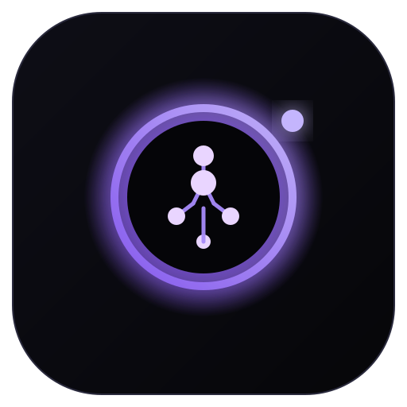
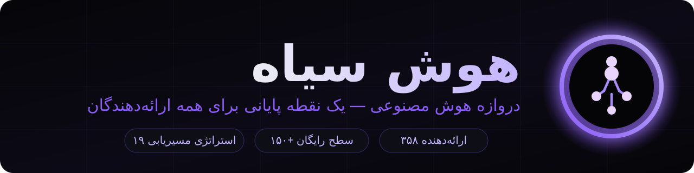

<div align="center">



<br/>
<br/>

# هوش سیاه — Hooshe Siah

**دروازه هوش مصنوعی آزاد — یک نقطه پایانی برای همه ارائه‌دهندگان**



[](./LICENSE)
[](#-فارسیسازی-و-rtl)
[](#-پوسته-تیره-هوش-سیاه)

</div>

---

## ✨ معرفی

**هوش سیاه** (به انگلیسی: Hooshe Siah / Black Intelligence) یک دروازه هوش مصنوعی محلی و متن‌باز است که تمام مدل‌ها و ابزارهای هوش مصنوعی شما را پشت **یک نقطه پایانی سازگار با OpenAI** جمع می‌کند. این پروژه باز-برندسازی و فارسی‌سازی عمیق پروژه [OmniRoute](https://github.com/diegosouzapw/OmniRoute) است که با هویت بصری کاملاً جدید، پشتیبانی پیشرفته از زبان فارسی و تمرکز بر تجربه کاربران فارسی‌زبان ارائه می‌شود.

هوش سیاه روی دستگاه خود شما اجرا می‌شود؛ داده‌هایتان از سیستم‌تان خارج نمی‌شود و هیچ تلمتری به بیرون ارسال نمی‌گردد. کافی است سرویس‌های هوش مصنوعی مختلف (رایگان یا پولی) را یک‌بار به آن معرفی کنید تا از آن پس همه درخواست‌ها به‌صورت هوشمند مسیریابی شوند: اگر یک مدل خطا بدهد یا سهمیه‌اش تمام شود، به‌طور خودکار به بهترین گزینه بعدی سوییچ می‌شود. نام پروژه از استعاره گرفتگی خورشید می‌آید: قرصی سیاه که هاله بنفش هوش پشت آن می‌درخشد.

## 🎯 ویژگی‌ها در یک نگاه

| ویژگی | توضیح |
| --- | --- |
| 🌐 **۳۵۸ ارائه‌دهنده** | OpenAI، Anthropic، Gemini، Groq، Mistral و صدها مورد دیگر |
| 🆓 **۱۵۰+ سطح رایگان** | حدود ۱.۶۲ میلیارد توکن رایگان در ماه از استخرهای سهمیه |
| 🔀 **۱۹ استراتژی مسیریابی** | اولویت‌محور، Round-Robin، Quota-Share و موارد دیگر |
| 🧬 **فشرده‌سازی هوشمند** | صرفه‌جویی ۱۵ تا ۹۵ درصدی توکن (میانگین حدود ۸۹٪) |
| 🛡️ **Fallback خودکار** | سوییچ خودکار در خطا یا اتمام سهمیه |
| 🇮🇷 **فارسی + RTL کامل** | رابط فارسی با فونت وزیرمتن و چیدمان راست‌به‌چپ |
| 🌑 **پوسته تیره اختصاصی** | تم پیش‌فرض سیاهِ عمیق با درخشش بنفش |
| 🖥️ **سه حالت اجرا** | وب، دسکتاپ (Electron) و PWA قابل نصب |
| 🔧 **ابزارهای کدنویسی** | Claude Code، Codex، Cursor، Cline، Copilot و Antigravity |

## 🚀 شروع سریع

```bash
git clone https://github.com/amirabrand/hooshe-siah.git
cd hooshe-siah
npm install
npm run dev
```

سپس داشبورد: `http://localhost:20128/dashboard`

راهنمای کامل و گام‌به‌گام: [QUICKSTART.md](./QUICKSTART.md)

## 🇮🇷 فارسی‌سازی و RTL

- رابط کاربری به‌طور خودکار زبان مرورگر را تشخیص می‌دهد و در محیط فارسی، چیدمان **راست‌به‌چپ** می‌شود.
- فونت **وزیرمتن** به‌صورت محلی بسته‌بندی شده (بدون وابستگی به CDN).
- تمام واژگان رابط، راهنماها و پیام‌ها فارسی‌سازی شده و از نیم‌فاصله صحیح استفاده می‌شود.
- مستندات فارسی در مخزن اصلی: `docs/fa/`

## 🌑 پوسته تیره «هوش سیاه»

هویت بصری پروژه بر پایه سیاهی عمیق (`#060609`) و بنفش نئونی (`#8b5cf6`) طراحی شده است. تم تیره به‌صورت پیش‌فرض فعال است و نشان لوگو — گرفتگی خورشید با سیناپس عصبی درخشان — در سراسر رابط، فاویکون و آیکون دسکتاپ تکرار می‌شود.

## 📦 مخازن پروژه

| مخزن | دسترسی | محتوا |
| --- | --- | --- |
| [`amirabrand/hooshe-siah`](https://github.com/amirabrand/hooshe-siah) | 🔒 خصوصی | سورس کامل پروژه |
| `amirabrand/hooshe-siah-intro` | 🌍 عمومی | همین معرفی رسمی |

## 📄 مجوز

MIT — بر پایه پروژه [OmniRoute](https://github.com/diegosouzapw/OmniRoute) اثر [Diego Souza](https://github.com/diegosouzapw). باز-برندسازی، طراحی مجدد و فارسی‌سازی توسط [@amirabrand](https://github.com/amirabrand) انجام شده است.
